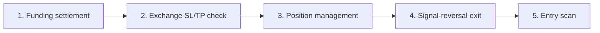
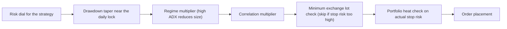
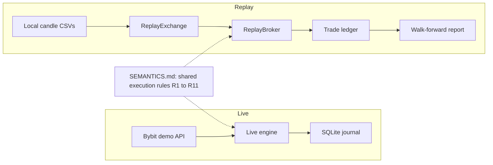

# trading-engine

**A conservative, demo-only crypto trading engine whose live execution path and replay/walk-forward harness share one execution-semantics specification. It is built to be safe by default and never to place an order by accident.**

[](https://github.com/Hassnain2003/trading-engine/actions/workflows/ci.yml)

[](LICENSE)

---

## Disclaimer (read first)

trading-engine is an **educational and engineering project**, not financial advice. It makes **no profit, return, or win-rate claims**. The default venue is **Bybit demo/sandbox**, trading is **disabled by default**, and the engine **refuses mainnet** unless you explicitly set two consent flags. If you override those safeties and connect to mainnet, you can lose real money. Use at your own risk.

---

## Table of contents

1. [What this is](#what-this-is)
2. [Features](#features)
3. [Architecture](#architecture)
4. [How one bar is processed](#how-one-bar-is-processed)
5. [Live engine and replay harness: one set of semantics](#live-engine-and-replay-harness-one-set-of-semantics)
6. [Risk manager](#risk-manager)
7. [Strategies](#strategies)
8. [Research and walk-forward evaluation](#research-and-walk-forward-evaluation)
9. [Data](#data)
10. [Persistence and observability](#persistence-and-observability)
11. [Safe by default](#safe-by-default)
12. [Quick start (Bybit demo only)](#quick-start-bybit-demo-only)
13. [Configuration](#configuration)
14. [Tests and CI](#tests-and-ci)
15. [Repository layout](#repository-layout)
16. [Limitations](#limitations)
17. [Research honesty](#research-honesty)
18. [Roadmap](#roadmap)
19. [License](#license)

---

## What this is

Most trading-bot repositories show a signal and a backtest. This project is about the part that usually goes wrong in production: **executing safely and proving that what you tested is what runs.**

It has three goals:

1. **Execute conservatively.** A central risk manager decides whether any entry may be placed, and it fails closed.
2. **Test what runs.** The live engine and the replay harness follow the same documented execution semantics (`research/SEMANTICS.md`), so a walk-forward result is comparable to live behaviour.
3. **Decide with rules written in advance.** Strategies must pass preregistered eligibility rules (`research/PREREG.md`) on out-of-sample data before they are considered for live capital. Strategies that failed were disabled, and this README says so.

---

## Features

- Live execution engine for Bybit linear perpetuals (BTC, ETH), with IOC marketable orders, exchange-hosted stop-loss and take-profit, and trailing stops.
- Centralized, fail-closed risk manager: daily and weekly breakers, per-strategy risk dials, notional caps, and portfolio heat limits.
- Position reconciliation against the trade journal, and a funding-history sync.
- Replay and walk-forward harness that reproduces live execution bar by bar on local candle data.
- Preregistered eligibility rules (E1 to E7) and a go-live gate with explicit thresholds.
- SQLite trade journal in WAL mode, with daily verified backups and a git hash and config hash recorded on every signal.
- Single-instance lock, health HTTP endpoint, API circuit breaker, and startup reconciliation.
- Alerting through ntfy, Discord, and email, plus a scheduler for pre-session, intraday, post-session, and weekly jobs.
- Streamlit dashboard that reads the journal.
- pytest suite, GitHub Actions CI with secret scanning and dependency auditing.

---

## Architecture

```mermaid
flowchart TD
    subgraph CFG["Configuration"]
        YAML["config.yaml + SECTION__KEY env overrides"]
        PHASE["trading_phase.py: phase constants and per-phase journal"]
    end

    subgraph VENUE["Bybit (demo/sandbox by default)"]
        PUB["Public REST: candles, tickers, order books, funding"]
        PRIV["Private API (demo): orders, positions"]
    end

    subgraph ENGINE["Live engine (execution/)"]
        ENG["engine.py: orchestrator and health endpoint"]
        MKT["market_data.py: tickers, books, correlation"]
        SCAN["entry_scanner.py: entry scan and gates"]
        ORD["order_manager.py: IOC orders, SL/TP, flatten"]
        MGMT["position_manager.py, s7_manager.py: trailing stops, daily flips"]
        SYNC["position_sync.py, funding_sync.py: reconciliation and funding"]
    end

    STRAT["strategies/: signal generators (S2, S7 active)"]
    RISK["risk/risk_manager.py: breakers, sizing, heat, caps"]
    JRN[("SQLite journal (WAL mode)")]

    subgraph OPS["Ops"]
        ALERT["Alerting: ntfy, Discord, email"]
        SCHED["Scheduler: pre-session, intraday, post-session, weekly"]
        DASH["Streamlit dashboard"]
    end

    subgraph RESEARCH["Research harness (research/)"]
        LOAD["data_loader.py: local CSV candles"]
        REX["ReplayExchange: pin-able clock, no lookahead"]
        RBR["ReplayBroker: live semantics, trade ledger"]
        WF["walkforward.py: OOS windows and PREREG checks"]
    end

    YAML --> ENG
    PHASE --> ENG
    PUB --> MKT
    MKT --> SCAN
    STRAT --> SCAN
    SCAN --> RISK
    RISK --> ORD
    ORD --> PRIV
    ENG --> MGMT
    ENG --> SYNC
    SYNC --> PRIV
    ORD --> JRN
    SYNC --> JRN
    JRN --> DASH
    JRN --> ALERT
    SCHED --> ALERT

    LOAD --> REX --> RBR --> WF
    STRAT -. same signal functions .-> RBR
    RISK -. same risk rules .-> RBR
    RBR -.|same execution semantics|- ENG
```

**Reading the diagram:** data flows from the venue into the scanner, signals from strategies are gated by the risk manager, and only then does the order manager talk to the exchange. Everything the engine does is written to the journal. The research harness reuses the same strategy functions and the same risk manager against local candles.

### Module connections

| Layer | Modules | Role |
|---|---|---|
| Configuration | `config.yaml`, `utils/config_loader.py`, `trading_phase.py` | YAML plus environment overrides (`SECTION__KEY`), phase constants, per-phase journal file |
| Engine | `execution/engine.py` | Orchestrates each cycle, runs the health endpoint, holds the single-instance lock via `live/agent_runner.py` |
| Entry path | `entry_scanner.py`, `market_data.py`, `utils/gate.py`, `utils/correlation.py` | Scans strategies, applies liquidity gate and portfolio heat, builds the correlation matrix |
| Orders | `order_manager.py` | IOC marketable and limit orders, SL/TP placement, flatten, pending-order reconciliation |
| Positions | `position_manager.py`, `s7_manager.py`, `position_sync.py`, `funding_sync.py` | Trailing stops, daily momentum flips, reconciliation against the journal, funding sync |
| Risk | `risk/risk_manager.py` | The single gate for new entries; sizing, breakers, heat, notional caps |
| Strategies | `strategies/` | Signal generators that return a signal dict or none |
| Research | `research/` | Replay exchange and broker, walk-forward runner, preregistered rules |
| Ops | `claude/`, `dashboard.py`, `deploy/`, `scripts/` | Notifications, scheduled jobs, dashboard, deployment examples, operational scripts |

---

## How one bar is processed

The engine evaluates once per new closed 5-minute bar. The order of operations is deliberate and is the same in the replay harness.



1. **Funding** (at 00:00, 08:00, 16:00 UTC): apply Bybit funding to open positions and record it.
2. **Exchange-hosted SL/TP:** intrabar check against the bar's OHLC. A gap at the open is evaluated first, and the stop is assumed to fill before the target when both are inside the range.
3. **Management:** daily risk lock, weekly kill switch, trailing stops, daily momentum flips, and a maximum position age.
4. **Signal-reversal exit:** rerun the strategy for each open position and close if its side now opposes the position.
5. **Entry scan:** strategies are scanned in registry order, with a per-strategy daily entry cap, one owner per symbol, a liquidity gate, and a portfolio heat gate. Entries are IOC limit orders priced slightly across the book.

### Entry sizing chain



---

## Live engine and replay harness: one set of semantics

`research/SEMANTICS.md` traces the production behaviour (rules R1 to R11) back to the live code, including the deliberate deviations the harness makes (section 8). The harness provides:

- **`ReplayExchange`:** serves candles from the local dataset as of a simulated "now". It rebuilds forming bars from completed 5-minute candles so there is no lookahead, and it reproduces the exchange API's candle semantics.
- **`ReplayBroker`:** reproduces live execution bar by bar (funding, intrabar SL/TP with gap-open and stop-first rules, trailing stops, locks, flips, age limits) and emits a trade ledger with P&L, fees, slippage, funding, and R-multiples.
- **`patched_now()`:** pins the wall clock inside strategy modules during replay.



The replay is an approximation of live execution, not a guarantee. Its deliberate conventions are documented in `research/SEMANTICS.md`.

---

## Risk manager

`risk/risk_manager.py` is the single gate for new entries. It is fail-closed: it blocks trading until equity is established.

**Breakers**

| Breaker | Behaviour |
|---|---|
| Daily loss lock | Session P&L at or below -2% blocks new entries for the rest of the UTC day |
| Daily flatten | Session P&L at or below -4% closes all positions |
| Daily profit target | Reaching +2% blocks new entries (a lock, not a quota); open positions keep running |
| Weekly kill switch | 7% rolling drawdown from the high-water mark halts new entries until the next UTC week |
| Maximum position age | 7 days forces a close |

**Sizing**

- Position size is equity times the strategy's risk dial, divided by the stop distance.
- Conservative default dials: S2 1.5%, S7 0.8%. A hard per-trade risk ceiling applies.
- A minimum lot whose stop risk would exceed 2% of equity is skipped entirely.
- Regime and correlation multipliers only scale size down.

**Heat and caps**

- Portfolio heat: the candidate's actual stop risk plus the stored planned risk of open positions must stay under 6% of equity. Correlated risk is capped separately.
- Per-strategy notional caps: S2 25%, S7 12%, default 10%.

**Go-live gate** (`utils/stats.py`): net-of-cost demo metrics must pass profit factor above 1.3, Sharpe above 1.0, max drawdown below 15%, and at least 60 trades before live trading is even considered.

Configuration precedence (lowest to highest): `config.yaml` sections, phase constants in `trading_phase.py`, then `SECTION__KEY` environment overrides.

---

## Strategies

| Strategy | Markets | Logic (summary) | Status |
|---|---|---|---|
| S2 Breakout Retest | BTC, 5m | Opening-range breakout with volume confirmation, retest within a band, EMA ribbon trend filter | Active |
| S7 Daily Momentum | BTC, ETH | Prior UTC day's return direction; hold until the next daily flip; stops are catastrophic guards plus a soft-loss cap | Active |
| S1, S3, S4, S5 | | RSI reversion, VWAP bands, RSI/MACD, MA crossover | Disabled after walk-forward (see Research honesty) |

All active strategies use IOC limit orders, so both entry and exit are taker fills, and fees and slippage are modelled that way.

Strategy modules export a signal function that returns a signal dictionary (symbol, side, price, stop loss, take profit, label, order type, time) or nothing.

---

## Research and walk-forward evaluation

`research/walkforward.py` runs the replay across the dataset and reports metrics per out-of-sample window and overall.

**Preregistered eligibility rules (`research/PREREG.md`)**

| Rule | Threshold |
|---|---|
| E1 | Net expectancy at least +0.15 R |
| E2 | Bootstrap 90% lower bound above 0 |
| E3 | Net profit factor at least 1.30 |
| E4 | Random-entry p-value below 0.05 |
| E5 | Positive in at least 3 of 4 out-of-sample windows |
| E6 | Max drawdown at most 15% |
| E7 | Still positive with fees times 1.5 and slippage times 2 |

The rules were written before the runs, so a strategy cannot be tuned until it passes.

Run the replay harness (after downloading data):

```bash
python -m research.walkforward
```

---

## Data

Market data comes from the **Bybit public REST v5 API** (no API key needed). BTC and ETH perpetuals at 5m, 15m, and 1d (1h and 1d are also resampled from 5m), plus 8-hourly funding history.

```bash
python data/download_data.py
```

- Deterministic daily chunks; resumable (existing chunks are skipped); retries with backoff on rate limits.
- Writes per-chunk CSVs, a SHA-256 manifest (`data/checksums.sha256`), a cutoff record (`data/cutoff.txt`), and a gap report (`data/gap_report.txt`).
- The raw CSVs are large and are **not** committed (`data/*.csv` is gitignored). Only the manifest, cutoff, gap report, and the downloader are in the repository.

---

## Persistence and observability

- **Journal:** SQLite in WAL mode (so the dashboard can read while the engine writes), a busy timeout, one database per phase, daily backups with verification. Tables include signals, orders, equity snapshots, funding payments, and key-value state.
- **Auditability:** every signal records the git hash and a config hash.
- **Health:** the engine exposes an HTTP health endpoint with status, equity, and daily P&L. A single-instance lock prevents two engines from trading one account.
- **Reliability:** an API-health circuit breaker, startup reconciliation, and position sync with one owner per contract.
- **Alerts:** ntfy push, Discord webhook, and email for entries, exits, kill switches, circuit-breaker events, and sync errors. See `ALERTS.md`.
- **Dashboard:** `streamlit run dashboard.py` shows live metrics from the journal.

---

## Safe by default

| Safeguard | Behaviour |
|---|---|
| Demo venue | `BYBIT_DEMO=true` by default; examples point to the sandbox only |
| Mainnet interlock | Refuses to start on mainnet unless **both** `ALLOW_MAINNET=true` and `I_UNDERSTAND_THE_RISK=yes` are set |
| Trading opt-in | No new orders unless `ENABLE_TRADING=true` |
| Startup banner | A clear demo/paper banner at startup |
| No secrets in the repo | Keys, webhooks, and passwords come from environment variables; `.env` is gitignored |
| Secret scanning | gitleaks runs in pre-commit and in CI |

---

## Quick start (Bybit demo only)

```bash
# 1. Clone
git clone https://github.com/Hassnain2003/trading-engine.git
cd trading-engine

# 2. Create your environment file (never commit .env)
cp .env.example .env
# Fill BYBIT_API_KEY and BYBIT_API_SECRET for a Bybit DEMO account only.
# Leave them blank to run without any venue connection.

# 3. Install dependencies (Python 3.12)
python -m pip install -r requirements.txt
python -m pip install pytest ruff

# 4. Run the engine on demo. Trading is disabled by default, so no orders are placed.
python3 live/agent_runner.py

# To allow new orders on the demo account:
ENABLE_TRADING=true python3 live/agent_runner.py
```

Optional: download data with `python data/download_data.py` and run the dashboard with `streamlit run dashboard.py`.

---

## Configuration

Settings live in `config.yaml` and can be overridden with environment variables using the `SECTION__KEY` convention, for example `RISK__DAILY_LOSS_LOCK_PCT=0.03`. Secrets and consent flags are environment-only. See `.env.example` for every variable: venue and keys, `ALLOW_MAINNET`, `I_UNDERSTAND_THE_RISK`, `ENABLE_TRADING`, risk dials, and alert destinations.

---

## Tests and CI

```bash
python -m pytest tests/ -v
ruff check --select=E9,F63,F7,F82 .
gitleaks detect --source . --no-git --verbose
```

The test suite covers the risk manager (sizing, caps, breakers, the weekly kill switch), the entry scanner, order management, position sync, statistics and the go-live gate, configuration loading, correlation and portfolio-heat caps, minimum-lot handling, the circuit breaker, WAL and backup behaviour, and market data collection.

GitHub Actions (`.github/workflows/ci.yml`) runs on every push and pull request: a gitleaks secret scan, pytest, pip-audit on the pinned requirements (findings are reported, not hidden), ruff, and a module-import check.

---

## Repository layout

```text
trading-engine/
├── execution/        Live engine: orchestrator, orders, positions, funding, market data
├── risk/             Central risk manager
├── strategies/       Signal generators (S2 and S7 active; others disabled)
├── research/         Replay exchange and broker, walk-forward, SEMANTICS.md, PREREG.md
├── utils/            Config loader, liquidity gate, correlation, statistics
├── live/             Runner with single-instance lock
├── backtest/         Historical strategy studies
├── data/             Downloader, checksums, cutoff, gap report (no raw CSVs)
├── deploy/           Deployment examples (systemd unit, install scripts)
├── scripts/          Operational scripts
├── tests/            pytest suite
├── docs/             Architecture notes and demo placeholders
├── claude/           Alerting, scheduling, and LLM clients
├── dashboard.py      Streamlit dashboard
├── config.yaml       Configuration
├── trading_phase.py  Phase constants
└── ALERTS.md, SECURITY.md, CONTRIBUTING, LICENSE
```

---

## Limitations

- Defaults to Bybit demo; even with both consent flags, mainnet means real money at your own risk.
- Indicator libraries (pandas-ta, numba) need Python below 3.14; CI uses 3.12.
- The replay harness uses deliberate conventions (intrabar fills, mark versus last price), documented in `research/SEMANTICS.md` section 8. It approximates live execution and does not guarantee it.
- Demo order books can differ from mainnet; some thin symbols were excluded for that reason.
- No strategy is guaranteed to be profitable.
- Single-venue, single-account design.

---

## Research honesty

Strategies **S1, S3, S4, and S5** were disabled after walk-forward evaluation showed no edge against the preregistered rules in `research/PREREG.md`. None passed the gate, so they are registered in the strategy configuration but excluded from the active list.

Strategy **S9** was removed entirely from this public copy.

No profit, return, or win-rate claims are made anywhere in this repository.

---

## Roadmap

- Record a demo GIF and walkthrough video (`docs/demo/`).
- Add integration tests against a mocked exchange for the full order lifecycle.
- Publish a sample walk-forward report from the small downloadable dataset.

---

## License

[MIT](LICENSE). Copyright (c) 2026 Hassnain Abbas.
